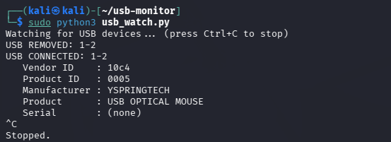
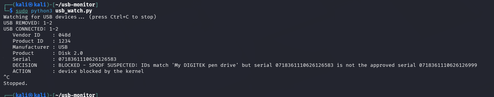
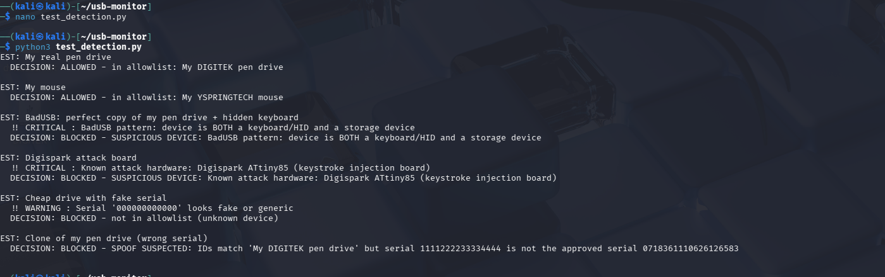
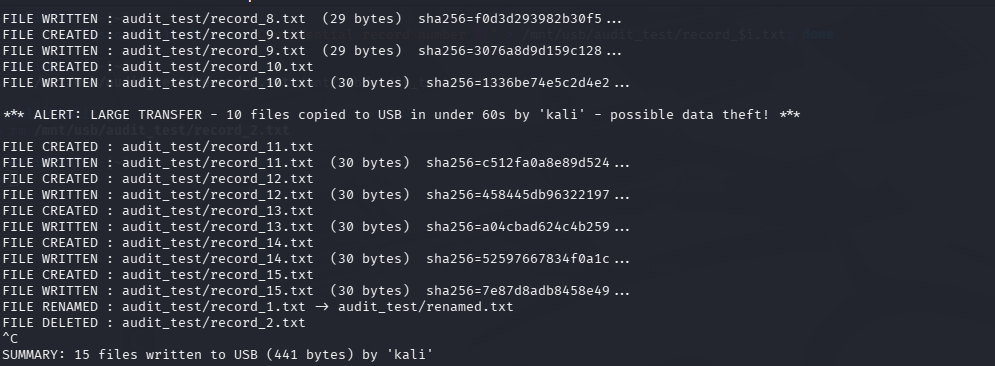
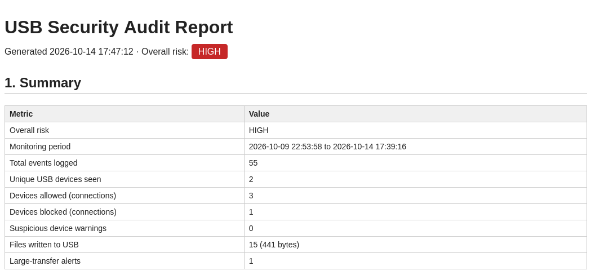

# USB Device Control & Monitoring Framework

A Python framework for **Kali Linux** that detects, fingerprints, controls and audits USB devices in real time.
It automatically blocks unauthorized, cloned and BadUSB devices, tracks every file copied to USB drives,
and generates an HTML security audit report.

**Author:** Anjali Jyothikumar

---

## Features

| Objective | How it is done |
|---|---|
| Detect USB plug / unplug in real time | Listens to Linux kernel **udev** events with `pyudev` |
| Device fingerprinting | Vendor ID, Product ID, serial, manufacturer, product and **interface class**, read from `/sys/bus/usb/devices/` |
| Allowlist / blocklist | Rules in `policy.json`, with **default deny** for unknown devices |
| Auto-block unauthorized devices | Writes `0` to the device's `authorized` file, so the kernel detaches its drivers instantly |
| Clone / spoof detection | Device IDs match an approved device but the **serial is different** → blocked |
| BadUSB detection | A device that is **both a keyboard (HID) and storage** → blocked, even if allowlisted |
| Known attack hardware | IDs of Digispark, Teensy, Arduino Leonardo, Pro Micro → blocked |
| Fake serial detection | Serials like `000000000000` or `123456789` → warning |
| File movement auditing | `watchdog` (inotify) logs every file created, written, renamed or deleted on the USB drive, with size, user and **SHA-256** hash |
| Large transfer alert | 10+ files copied within 60 seconds → possible data theft alert |
| Logging | Every event is saved with a timestamp in `logs/usb_events.log` (JSON lines) |
| Reporting | `report.py` builds an HTML audit report with risk level, devices, alerts and file activity |

## How it works

```
START
  ↓
Monitor USB events (udev)
  ↓
Extract device info (VID, PID, serial, names, interface classes)
  ↓
Run security checks (BadUSB, attack hardware, fake serial)
  ↓
Check blocklist → allowlist (+ serial match)
  ↓
Authorized? ── yes → ALLOW
  │
  no → BLOCK (echo 0 > authorized) + log the attempt
  ↓
Audit file movements on approved USB drives
  ↓
Generate the USB security report
  ↓
END
```

## Project files

| File | Purpose |
|---|---|
| `usb_watch.py` | Main monitor: detects devices, runs the checks, allows or blocks, logs events |
| `file_audit.py` | Watches a mounted USB drive and logs all file activity |
| `report.py` | Reads the log and generates `reports/usb_audit_report.html` |
| `test_detection.py` | Tests the detection logic with simulated attack devices |
| `policy.json` | Allowlist, blocklist and known attack hardware |
| `logs/usb_events.log` | Audit trail of all events |
| `docs/screenshots/` | Screenshots of every stage |

## Requirements

- Kali Linux (or any Linux with udev)
- Python 3
- `python3-pyudev`, `python3-watchdog`

```bash
sudo apt install -y python3-pyudev python3-watchdog
```

> When running Kali in VirtualBox, pass the USB device into the VM from **Devices → USB**.

## Usage

**1. Monitor and control USB devices** (needs root to block devices):
```bash
sudo python3 usb_watch.py
```

**2. Audit files on a mounted USB drive** (in a second terminal):
```bash
sudo mount -o uid=kali,gid=kali /dev/sdb1 /mnt/usb
python3 file_audit.py /mnt/usb
```

**3. Generate the audit report:**
```bash
python3 report.py
firefox reports/usb_audit_report.html
```

**4. Run the detection tests:**
```bash
python3 test_detection.py
```

## Policy example

```json
{
  "allowlist": [
    {"vendor_id": "048d", "product_id": "1234", "serial": "0718361110626126583", "description": "My pen drive"}
  ],
  "blocklist": [
    {"vendor_id": "1234", "product_id": "5678", "description": "Example banned device"}
  ],
  "known_attack_hardware": [
    {"vendor_id": "16d0", "product_id": "0753", "description": "Digispark ATtiny85"}
  ]
}
```

## Sample output

```
USB CONNECTED: 1-2
   Vendor ID    : 048d
   Product ID   : 1234
   Serial       : 0718361110626126583
   Interfaces   : Mass Storage
   DECISION     : BLOCKED - SPOOF SUSPECTED: IDs match 'My DIGITEK pen drive' but serial 0718361110626126583 is not the approved serial 0718361110626126999
   ACTION       : device blocked by the kernel
```

```
*** ALERT: LARGE TRANSFER - 10 files copied to USB in under 60s by 'kali' - possible data theft! ***
```

## Screenshots

| | |
|---|---|
| Real-time detection |  |
| Automatic blocking |  |
| Clone (serial spoof) detection |  |
| BadUSB detection tests |  |
| File auditing |  |
| Audit report |  |

## Limitations

- Linux only (uses sysfs and udev).
- Blocking is reactive: a device is blocked a fraction of a second after it connects.
- A device that copies **every** detail of an approved device, including the serial, can only be caught by its interfaces (e.g. a hidden keyboard).
- Copying files **from** USB to the computer is not tracked; only changes on the USB drive are.

## Disclaimer

Built for learning and for use on systems you own or are authorized to test.
